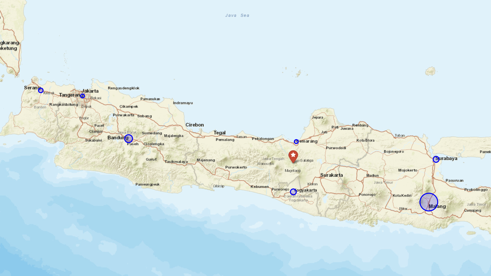

# Supply Chain Center of Gravity (CoG) Model - Java Logistics Network

An optimization model designed to determine the optimal facility location (warehouse/distribution center) by minimizing transportation costs across key demand hubs in Java, Indonesia.

## Mathematical Formulation

The optimal facility coordinates are calculated using the center of gravity weighted average model:

$$
\text{CoG}_x = \frac{\sum (X_i \times W_i)}{\sum W_i}
$$

$$
\text{CoG}_y = \frac{\sum (Y_i \times W_i)}{\sum W_i}
$$

Where:
- $X_i, Y_i$: Geographic coordinates (Longitude, Latitude) of demand hub $i$.
- $W_i$: Demand volume (in Tons) acting as the spatial weight.

## Visual Map Preview

### Visual Legend
- **Blue Circles**: Demand hubs (Java cities) with radius dynamically scaled based on `Demand_Ton`.
- **Red Star**: Mathematically calculated optimal facility location (Center of Gravity).

## Dataset & Demand Hubs

| City | Region | Latitude | Longitude | Demand (Ton) |
| :--- | :--- | :--- | :--- | :--- |
| Jakarta | Special Capital Region | -6.2088 | 106.8456 | 2346 |
| Bandung | West Java | -6.9175 | 107.6191 | 4969 |
| Semarang | Central Java | -6.9666 | 110.4197 | 2478 |
| Surabaya | East Java | -7.2575 | 112.7521 | 3446 |
| Yogyakarta | Special Region of Yogyakarta | -7.7956 | 110.3695 | 3798 |
| Malang | East Java | -7.9666 | 112.6326 | 10848 |
| Serang | Banten | -6.1154 | 106.1503 | 2653 |

## Tech Stack

- pandas
- numpy
- folium
